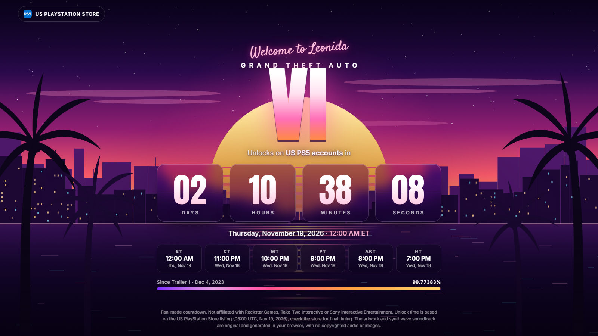
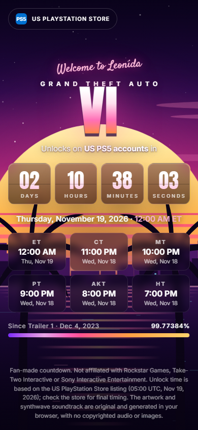
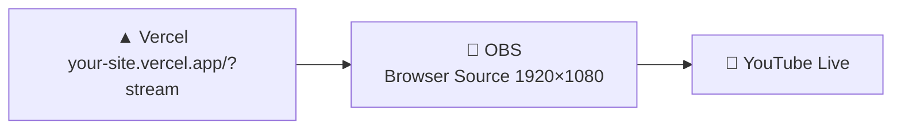
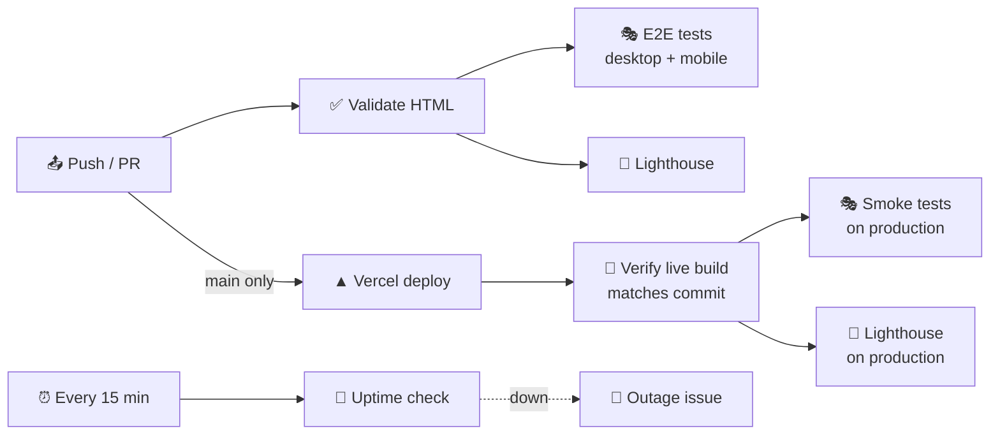

<div align="center">



<br>

# 🌴 GTA VI Countdown · US PS5

**A fan-made, single-page countdown to the moment GTA VI unlocks on US PlayStation 5 accounts.**<br>
Sunset skyline, original synthwave soundtrack, and a broadcast-ready stream mode for YouTube Live.

<br>


[](https://github.com/risindu-dev/gta6-countdown/actions/workflows/ci.yml)
[](https://github.com/risindu-dev/gta6-countdown/actions/workflows/cd.yml)
[](https://github.com/risindu-dev/gta6-countdown/actions/workflows/uptime.yml)

<br>

### [▶ Live demo: gta6-countdown-rho.vercel.app](https://gta6-countdown-rho.vercel.app)

<br>

[](https://vercel.com/new/clone?repository-url=https://github.com/risindu-dev/gta6-countdown)

[**Features**](#-features) · [**Unlock times**](#-unlock-times) · [**Deploy**](#-deploy-on-vercel) · [**Go live on YouTube**](#-go-live-on-youtube) · [**CI/CD**](#-cicd) · [**Customize**](#-customize)

</div>

<br>

## ✨ Features

<table>
<tr>
<td width="50%" valign="top">

### ⏱️ Live countdown
Days, hours, minutes and seconds on frosted-glass cards with a flip animation. The browser tab title counts down too.

</td>
<td width="50%" valign="top">

### 🇺🇸 Every US time zone
Unlock time shown for ET, CT, MT, PT, Alaska and Hawaii, plus the visitor's own local time, wherever they are.

</td>
</tr>
<tr>
<td valign="top">

### 🎵 Original soundtrack
A synthwave loop generated live in the browser with the Web Audio API. No audio files, no copyrighted music, so it's safe for streams.

</td>
<td valign="top">

### 🌅 Hand-built artwork
Sunset, skyline, ocean reflections and swaying palm trees, all drawn in SVG. The sun pulses with the bass.

</td>
</tr>
<tr>
<td valign="top">

### 🔴 Stream mode
Add `?stream` for a clean broadcast view: no buttons, no cursor, music starts automatically. Built for OBS browser sources.

</td>
<td valign="top">

### 🎉 Launch moment
At zero the page switches to **OUT NOW** with a confetti burst. Leave the stream running through launch.

</td>
</tr>
<tr>
<td valign="top">

### 📅 Add to calendar
One click downloads an `.ics` event with a 30-minute reminder. Works with Google, Apple and Outlook calendars.

</td>
<td valign="top">

### 📱 Works everywhere
Responsive from phones to 4K, respects reduced-motion settings, and loads as a single ~40 KB HTML file.

</td>
</tr>
</table>

<br>

<div align="center">

<br>
<sub>Mobile view</sub>
</div>

<br>

## 🕛 Unlock times

GTA VI unlocks on the US PlayStation Store at **05:00 UTC on Thursday, November 19, 2026**. That's a single nationwide moment, so the West Coast can start playing the night before.

| Time zone | Unlock |
| :-- | :-- |
| 🗽 **Eastern** (ET) | Thu, Nov 19 · **12:00 AM** |
| 🌾 **Central** (CT) | Wed, Nov 18 · **11:00 PM** |
| 🏔️ **Mountain** (MT) | Wed, Nov 18 · **10:00 PM** |
| 🌉 **Pacific** (PT) | Wed, Nov 18 · **9:00 PM** |
| ❄️ **Alaska** (AKT) | Wed, Nov 18 · **8:00 PM** |
| 🌺 **Hawaii** (HT) | Wed, Nov 18 · **7:00 PM** |

> [!NOTE]
> These times come from the US PlayStation Store listing. Rockstar hasn't published an official US time-zone breakdown, so check the store on launch day.

<br>

## 🚀 Run it locally

There's nothing to install to *view* it. Open `index.html` in any modern browser. For development:

```bash
npm install
npm start            # serve at http://localhost:4173
npm run lint         # validate HTML
npm test             # Playwright suite, desktop + mobile
npm run test:prod    # same suite against the live site
```

<br>

## ▲ Deploy on Vercel

**One click:** use the **Deploy with Vercel** button at the top of this page.

**Or manually:**

1. Go to [vercel.com/new](https://vercel.com/new) and import this repository.
2. Framework preset: **Other**. Leave the build command and output directory empty.
3. Hit **Deploy**. Every push to `main` redeploys automatically.

<br>

## 🔴 Go live on YouTube

Vercel hosts the page; OBS on your machine renders it and streams it to YouTube.



### Stream URLs

| URL | What you get |
| :-- | :-- |
| `/?stream` | Clean broadcast view with music |
| `/?stream&vol=0.5` | Same, at 50% volume (`0` – `1`) |
| `/?stream&mute` | Silent. Bring your own audio in OBS |

Stream mode also hides the "your local time" line, so viewers don't see the streaming computer's time zone.

### OBS setup

1. **Sources → ＋ → Browser**, paste `https://<your-site>.vercel.app/?stream`
2. Set **Width `1920`** and **Height `1080`**
3. Tick **Control audio via OBS** so the soundtrack shows up in the mixer
4. **Settings → Stream** → choose **YouTube** and connect your account (or paste the key from YouTube Studio → Go Live)
5. **Start Streaming** 🎬

> [!TIP]
> If the music doesn't start in OBS, right-click the source → **Interact** and click once on the page.

> [!IMPORTANT]
> The stream only runs while OBS is running. For a multi-day countdown, keep the machine awake (disable sleep), or run OBS on a cloud VM. YouTube keeps only the last 12 hours of streams longer than that as a replay; the live broadcast itself is unaffected.

<br>

## 🔁 CI/CD

Every change is validated, deployed, then re-tested against the live site.



| Workflow | Runs on | What it does |
| :-- | :-- | :-- |
| [**CI**](.github/workflows/ci.yml) | every push & pull request | HTML validation → Playwright end-to-end tests on desktop and mobile Chrome → Lighthouse audit with a report link in the run summary |
| [**CD**](.github/workflows/cd.yml) | push to `main` | Waits for Vercel to finish deploying, verifies production serves the **exact** `index.html` from the commit (SHA-256), then runs the full test suite and Lighthouse against the live URL |
| [**Uptime**](.github/workflows/uptime.yml) | every 15 minutes | Pings production; opens an `outage` issue if it's down (so GitHub notifies you) and closes it when it recovers |
| [**Dependabot**](.github/dependabot.yml) | weekly | Keeps GitHub Actions and dev tools up to date |

**What the tests cover:** exact countdown values on a frozen clock, second-by-second ticking, the final-24-hours glow, the switch to **OUT NOW** at unlock, all six US time zones, visitor time-zone detection (Los Angeles vs. Tokyo), music toggle, `.ics` export contents, `?stream` mode, and no horizontal scroll on mobile.

Deployment itself is handled by Vercel's Git integration: pushes to `main` go to production, and pull requests get preview URLs. `.vercelignore` keeps tests and tooling out of the deployed site.

<br>

## 🎨 Customize

| What | How |
| :-- | :-- |
| **Background photo** | Drop a royalty-free image (e.g. from [Unsplash](https://unsplash.com) or [Pexels](https://pexels.com)) next to `index.html` as **`bg.jpg`**. It replaces the drawn scene automatically. |
| **Unlock date** | Edit `UNLOCK` at the top of the `<script>` in `index.html` (UTC). |
| **Time zones** | Edit the `ZONES` list right below it. |
| **Colors** | Tweak the CSS variables in `:root` (`--pink`, `--orange`, `--cyan`, …). |
| **Keyboard** | Press <kbd>M</kbd> to toggle the music. Click the **VI** logo for confetti. |

<br>

## 🎵 About the soundtrack

The music is composed in code and synthesized live by your browser: an **Am → F → C → G** progression at 98 BPM, arranged as a 16-bar cycle (about 40 seconds) that keeps evolving.

| Bars | What plays |
| :-: | :-- |
| 1–2 | Warm detuned pad and a sustained bass |
| 3–4 | Arpeggio fades in with tempo-synced delay |
| 5–8 | Full groove: four-on-the-floor kick, snare, hats, pumping bassline |
| 9–16 | Lead melody with vibrato, ending in a snare roll back to the top |

All voices are oscillators and filtered noise, with no samples, so there's nothing for YouTube Content ID to match.

<br>

## 🗂️ Project structure

```
gta6-countdown/
├── index.html              ← the whole site: markup, styles, artwork, music, logic
├── vercel.json             ← security headers
├── .vercelignore           ← deploy only the site, not the tooling
├── tests/
│   └── countdown.spec.js   ← Playwright end-to-end suite
├── playwright.config.js
├── lighthouserc.json
├── .github/
│   ├── workflows/          ← ci.yml · cd.yml · uptime.yml
│   └── dependabot.yml
└── docs/                   ← screenshots for this README
```

<br>

---

<div align="center">
<sub>
Fan-made project. Not affiliated with, endorsed or sponsored by Rockstar Games, Take-Two Interactive or Sony Interactive Entertainment.<br>
<i>Grand Theft Auto</i> and <i>PlayStation</i> are trademarks of their respective owners. All artwork and music in this repo are original.
</sub>
<br><br>
Made with 🌅 for Leonida
</div>
